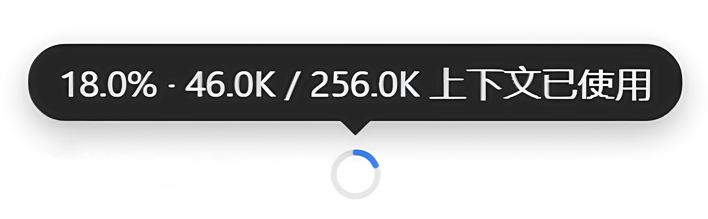
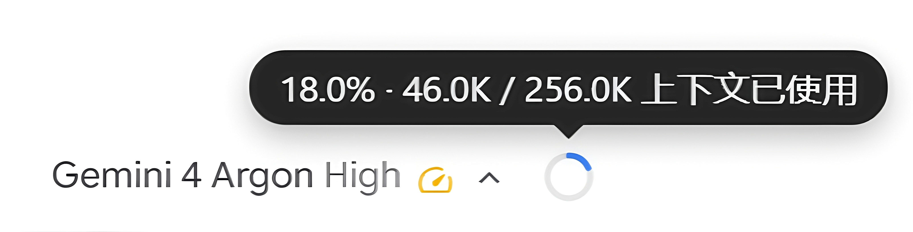
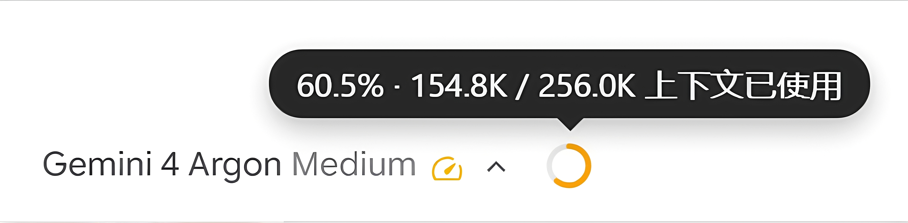
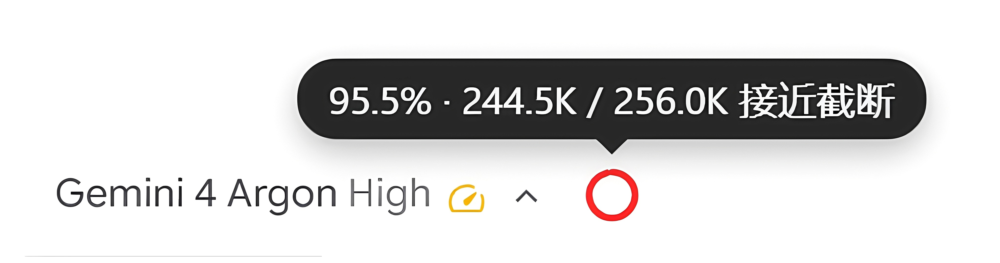
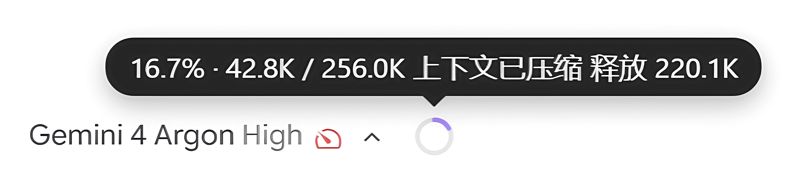
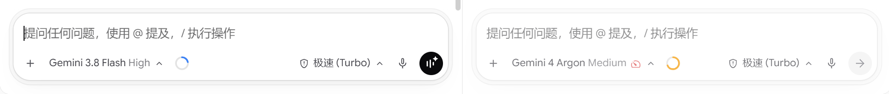
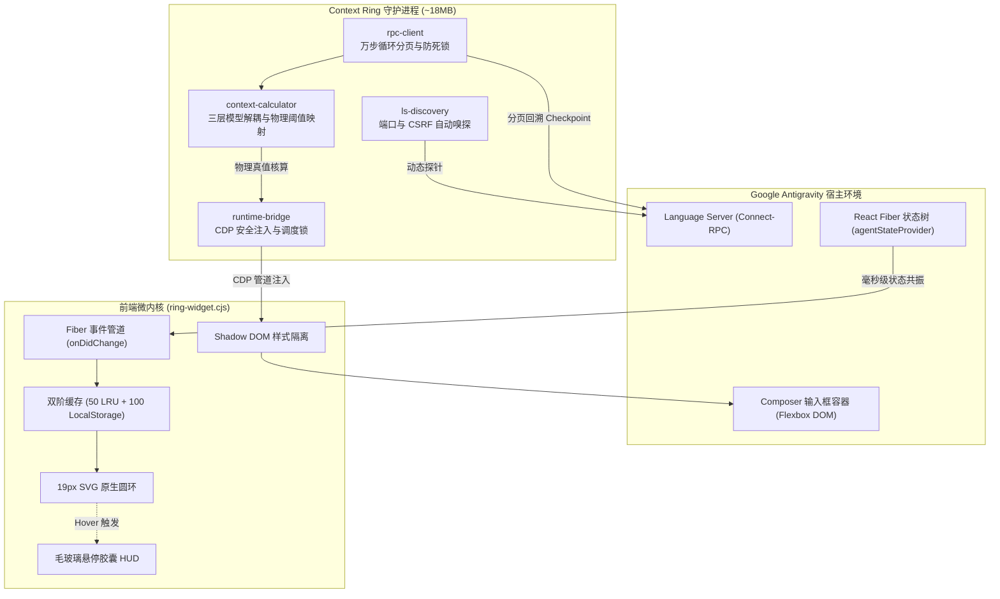

<div align="center">

# Antigravity Context Ring

**专为 Google Antigravity 桌面客户端 (Antigravity App) 打造的原生级行内上下文长度监控圆环**  
*Native inline context telemetry for Google Antigravity Desktop App. Zero-invasion, RPC ground-truth, 0ms instant switch.*

[](https://github.com/brien9/antigravity-context-ring/releases)
[](#)
[](#)

[](#)
[](#)
[](#)
[](#)

<a href="README.md">简体中文</a> | <a href="README_EN.md">English</a>

<br><br>



</div>

---

## ⚡ 极速安装 · Quick Start

跨平台零外部依赖。若 Antigravity 正在运行，安装后数秒内自动热注入生效。

> [!TIP]
> **🤖 Agent 自动安装（推荐 · 零终端操作）**  
> 直接复制下方一句话发给你的 Antigravity 助理即可全自动装好：  
> `帮我克隆 https://github.com/brien9/antigravity-context-ring.git 并执行 node manage.mjs install`

### 💻 终端手动安装 · Manual

```bash
git clone https://github.com/brien9/antigravity-context-ring.git && cd antigravity-context-ring

# 执行对应平台安装：
node manage.mjs install    # 全平台通用（推荐）
.\install.ps1              # Windows (PowerShell)
sh ./install.sh            # macOS / Linux
```
<sub>运维管理：`node manage.mjs status`（状态检查） · `node manage.mjs uninstall`（一键干净卸载，重启宿主即恢复）</sub>

---

## 💡 为什么需要它？ · Why Context Ring?

底层模型原生的上下文是 1M 级别，但 Antigravity 客户端把截断阈值写死在 **256K**，到点强制触发有损压缩，而官方 UI 全程不显示余量、压缩前也不预警。

Context Ring 把这根真实的截断线做成一颗 19px 的行内圆环：

| 核心维度 | 宿主原生默认 | 常见粗估方案 / 外部脚本 | Antigravity Context Ring |
| :--- | :--- | :--- | :--- |
| **截断分母基准** | 隐藏式管理，至 256K 自动触发压缩 | 多按 1M 或字符比估算，难反映实际截断线 | **锁定 256K 物理截断线**，在压缩前提供直观预警 |
| **Token 计量源** | 内部维持，界面未暴露实时读数 | 依赖字符估算，无法细分 Prompt Cache | **直读 Connect-RPC 快照**，解析真实 `modelUsage` |
| **交互形态** | 极简无额外元素 | 独立小窗口或终端命令打印 | **19px 原生行内圆环**，悬停即看毛玻璃 HUD |
| **多任务隔离** | 官方独立分屏 | 易受全局状态干扰，多屏时易混淆 | **React Fiber 节点绑定**，分屏状态互不串台 |
| **宿主安全性** | 官方原生 | 部分需解包修改 `app.asar` | **CDP 管道注入**，不改动宿主文件，常驻 ~18MB |

---

## 🎨 状态演进与分屏实测 · Visual States & Split View

### 1. 多阶状态演进与色彩反馈 (State Progression & Color Feedback)

圆环伴随上下文长度平滑演进。常规未压缩会话遵循四阶标准色标（科技蓝 `<60%` ➔ 琥珀黄 `60-80%` ➔ 暖橙 `80-90%` ➔ 纯正红 `≥90%`）；一旦检测到历史上下文发生过压缩（无论手动 `/compact` 还是自动压缩），在 `<60%` 安全期切换为清透的**薰衣草亮紫 (`#a78bfa`)** 标识“已压缩状态”，并在 `≥60%` 时自然衔接黄/橙/正红告警阶梯，直观清晰、不增加认知负担。

| 🟢 健康初期 (`< 60%`) | 🟡 注意过渡 (`60% ~ 80%`) |
| :---: | :---: |
|  |  |
| 🔴 临限极危 (`≥ 90%`) | 🟣 历史已压缩 (`Compacted < 60%`) |
| =90%) - approaching 256K auto-compaction truncation threshold" width="100%" style="border-radius: 6px; box-shadow: 0 2px 8px rgba(0,0,0,0.08);"> |  |

### 2. 多分屏独立隔离与实时联动 (Split View Isolation)

深度适配多 Composer 并行工作流，每个可见输入框拥有独立的生命周期与状态机实例（`Map<box, PaneRingInstance>`）：

<p align="center">
  
  <br>
  <em>多分屏实机：左屏 Gemini 3.8 Flash (草稿/健康) 与右屏 Gemini 4 Argon (活跃/警戒) 互不干扰，React Fiber 状态树天然隔离</em>
</p>

* **防串台铁律**：各分屏仅绑定自身 Fiber 节点，绝不回退读取全局路由，彻底杜绝“在右侧新建草稿却误偷左侧会话数据”的跨屏污染。
* **同会话跨屏共振**：当两个分屏同时打开同一个历史会话时，任一侧产生 Token 推进，两侧圆环毫秒级同步刷新。

---

## 🏗️ 核心工程机制 · Under the Hood



* **纯硬件级 RPC 快照（零字符猜测）**：遵循成熟 Harness 规范，直接从底层 Language Server 提取 `modelUsage` 结构，完整纳入输入、输出、`cacheReadTokens` 与 `cacheCreationTokens`。
* **三层模型解耦引擎**：严格区分 `selectedModel`（UI 主选模型，唯一决定分母）、`executionModel`（当前步骤执行模型）与 `checkpointModel`（快照落盘模型），根除 Subagent 临时调用轻量模型导致的进度条失真。
* **双阶 SWR 与 Never-Reset 防线**：内置 50 会话内存 LRU + 100 会话 LocalStorage 持久化快照。切换历史会话 0ms 渲染有效快照并后台静默校准；遇到窗口重载或 Language Server 偶发重启时，强制锁死最后一帧有效状态，绝不闪烁归零。
* **权威总步数 + 尾部窗口**：突破单次 RPC 查询的 1000 步限制；超过 5000 步时读取权威 `stepCount` 并聚焦最新 5000 步，确保当前 Checkpoint 不被旧前缀遮蔽，同时在气泡中明确标注“长会话尾部”。

---

## ❓ 常见问题 · FAQ

<details>
<summary><strong>Q1: 如何在不修改 app.asar 文件的前提下，在 Google Antigravity 中实时查看 Token 消耗与上下文余量？</strong></summary>

> **A**: 本插件采用 **100% 零侵入架构**，绝不解包或修改任何宿主二进制及 `resources/app.asar` 文件。后台 Sidecar 守护进程通过 Chrome DevTools Protocol (CDP) 会话注入轻量级原生微内核，通过 Connect-RPC 协议与本地 Language Server 通信，直接读取 `modelUsage` 快照并挂载于输入框 DOM。宿主平滑更新不损坏，卸载后重启宿主即刻恢复出厂状态。
</details>

<details>
<summary><strong>Q2: 多 Agent（Subagent）并发或多分屏（Split View）编码时，如何避免上下文进度条跳变与串台？</strong></summary>

> **A**: Context Ring 在前后端双向落实了**模型三层解耦体系**与**分屏独立状态树**。分母容量严格且仅由 UI 主选模型（`selectedModel`）唯一锁定，子任务调用轻量模型（如 `flash_lite`）绝不会篡改主圆环分母；同时在前端建立 `Map<box, PaneRingInstance>`，每个分屏仅绑定自身 React Fiber 节点，绝不读取全局状态，彻底杜绝跨屏串台。
</details>

<details>
<summary><strong>Q3: 守护进程常驻后台是否会影响 Antigravity 性能或消耗大量内存？</strong></summary>

> **A**: **完全不会**。后端 Node.js 守护进程常驻内存仅约 **18MB**，CPU 占用接近 **0%**；前端注入层为纯原生 DOM + SVG 微内核（无 React/Vue 运行时开销），结合 250ms 智能防抖节流与宿主进程看门狗（宿主退出即自动协同退出），对编辑器渲染与打字输入零负担。
</details>

---

## 📄 开源许可证 · License

本项目基于 [MIT 许可证](LICENSE) 开源发布。
