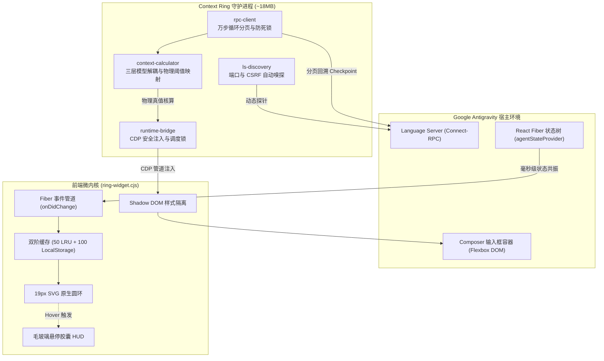

<div align="center">

# Antigravity Context Ring

**专为 Google Antigravity 桌面客户端 (Antigravity App) 打造的原生级行内上下文水位指示器**  
*Native inline context telemetry for Google Antigravity Desktop App. Zero-invasion, RPC ground-truth, 0ms instant switch.*

[](https://github.com/brien9/antigravity-context-ring/releases)
[](#)
[](#)

[](#)
[](#)
[](#)
[](#)

<a href="README.md">简体中文</a> | <a href="README_EN.md">English</a>

<br><br>


<sub>挂载于模型选择器同级容器的 19×19px 原生微圆环 · 平时静默陪伴，悬停毫秒级唤出毛玻璃监控气泡</sub>

</div>

---

## ⚡ 极速安装 · Quick Start

跨平台零外部依赖。若 Antigravity 正在运行，安装后数秒内自动热注入生效。

> [!TIP]
> **🤖 Agent 自动安装（推荐 · 零终端操作）**  
> 直接复制下方一句话发给你的 Antigravity 助理即可全自动装好：  
> `帮我克隆 https://github.com/brien9/antigravity-context-ring.git 并执行 node manage.mjs install`

### 💻 终端手动安装 · Manual

```bash
git clone https://github.com/brien9/antigravity-context-ring.git && cd antigravity-context-ring

# 执行对应平台安装：
node manage.mjs install    # 全平台通用（推荐）
.\install.ps1              # Windows (PowerShell)
sh ./install.sh            # macOS / Linux
```
<sub>运维管理：`node manage.mjs status`（状态检查） · `node manage.mjs uninstall`（一键干净卸载，重启宿主即恢复）</sub>

---

## 💡 为什么需要它？ · Why Context Ring?

在 Antigravity 中进行长链路深度编码时，每一位开发者都曾经历过模型突然“智商跳水”的绝望时刻：
- **“干着干着就失忆”的罪魁祸首 —— 256K 强制全损压缩**：  
  很多人误以为是 Gemini 偶尔“降智”或不听指令，但真相是**反重力的上下文黑盒机制在暗中作祟**。只要单会话上下文累积达到 **256K**（部分 Pro 模型甚至仅 128K），客户端就会强制触发后台自动压缩（Auto-Compaction）。  
  更致命的是，反重力的压缩并非无损保留，而是粗暴的**“全损压缩”**——先前的代码实现、架构设计、细微约束与排坑记录会被瞬间大量清洗甚至抹平，直接导致模型在前一轮还算力拉满，下一轮就突然失忆、指鹿为马。
- **认清真相：256K 根本不是模型极限，而是客户端的“订阅节流锁”**：  
  必须彻底分清底层模型能力与客户端策略的界限：**256K 绝非大模型的物理上下文极限**！无论是 Gemini 还是 Claude，官方底层 API 均原生支持 1M 甚至 2M 级别的超长上下文，API 接口从来不卡这个数字。客户端之所以把硬上限卡死在 256K，纯粹是官方为了**控制订阅额度的消耗速度与推理算力成本**。
- **视觉盲盒 vs 物理准星**：  
  官方 UI 全程不显示上下文消耗，更不会在压缩前发出任何预警，开发者只能在黑盒里裸奔。Context Ring 拒绝虚标的 1M/2M 宣传数字，**把准星死死咬在真实的 256K 物理节流线上**——在逼近临界截断（≥90% 警戒红）和全损压缩发生时毫秒级警示，让开发者彻底拿回会话生命周期的掌控权（及时收尾、分叉会话、交接档案）。

Context Ring 将上下文感知收敛为一颗 19px 的原生行内圆环，在准确度、原生感与响应速度上做到极致克制：

| 核心维度 | 原生盲盒 / 传统估算扩展 | Antigravity Context Ring |
| :--- | :--- | :--- |
| **截断分母基准** | 照搬 1M/2M 理论宣传上限，对平台 256K 强制压缩装聋作哑 | **对齐真实 256K 物理节流线**，在触发全损压缩与突发失忆前精准预警 |
| **Token 计量源** | 按 `4 chars/token` 粗暴估算，遇中文与代码缩进严重失真 | **Connect-RPC 硬件级快照**，直读底层 `modelUsage`（含 Cache 读写 Token） |
| **Subagent 并发** | 子任务调用小模型时篡改分母，导致进度条暴涨跳变 | **模型三层解耦**，仅由 UI 主选模型（`selectedModel`）唯一锁定分母容量 |
| **UI 交互形态** | 独立面板或状态栏长文本，频繁打断编码心流 | **19px 几何对齐 + Shadow DOM 隔离**，自动同步深浅主题，悬停即看、移开即隐 |
| **切换与容灾** | 切会话白屏等待，网络瞬断或服务重启时闪烁归零 | **L1 内存 + L2 持久化双阶 SWR**，切会话 0ms 秒开，断连坚守末帧稳定值 |
| **宿主安全性** | 解包修改 `resources/app.asar`，宿主更新即损坏 | **100% 零侵入**，通过 CDP 管道安全注入，常驻内存仅 ~18MB，升级零影响 |

---

## 🎨 状态演进与分屏实测 · Visual States & Split View

### 1. 收束汇流色彩反馈引擎 (Convergent Dual-Track Color Hierarchy)

圆环伴随上下文水位平滑演进。常规未压缩会话遵循四阶标准色标（科技蓝 `<60%` ➔ 琥珀黄 `60-80%` ➔ 暖橙 `80-90%` ➔ 纯正红 `≥90%`）；一旦检测到历史上下文发生过压缩（无论手动 `/compact` 还是自动压缩），在 `<60%` 安全期切换为清透的**薰衣草亮紫 (`#a78bfa`)** 标识“二周目摘要态”，并在 `≥60%` 时统一汇入标准黄/橙/正红告警轨，零色彩杂乱、直觉纯粹。

| 🟢 健康初期 (`< 60%`) | 🟡 注意过渡 (`60% ~ 80%`) |
| :---: | :---: |
| <br><sub>**原生科技蓝 (`#3b82f6`)**：静默陪伴；实测 Gemini 4 Argon High · 18.0% (46.0K / 256.0K)</sub> | <br><sub>**琥珀温润黄 (`#f59e0b`)**：提示会话进入深水区；实测 Gemini 4 Argon Medium · 60.5% (154.8K / 256.0K)</sub> |
| 🔴 临限极危 (`≥ 90%`) | 🟣 历史已压缩 (`Compacted < 60%`) |
| =90%) - approaching 128K/256K auto-compaction truncation threshold" width="100%" style="border-radius: 6px; box-shadow: 0 2px 8px rgba(0,0,0,0.08);"><br><sub>**高穿透纯正红 (`#ff2626`)**：逼近平台物理截断阈值；实测 Gemini 4 Argon High · 95.5% (244.5K / 256.0K 接近截断)</sub> | <br><sub>**薰衣草亮紫 (`#a78bfa`)**：全损压缩捕获；实测 Gemini 4 Argon High · 16.7% (42.8K / 256.0K 释放 220.1K)</sub> |

### 2. 多分屏独立隔离与实时联动 (Split View Isolation)

深度适配多 Composer 并行工作流，每个可见输入框拥有独立的生命周期与状态机实例（`Map<box, PaneRingInstance>`）：

<p align="center">
  
  <br>
  <em>多分屏实机：左屏 Gemini 3.8 Flash (草稿/健康) 与右屏 Gemini 4 Argon (活跃/警戒) 互不干扰，React Fiber 状态树天然隔离</em>
</p>

* **防串台铁律**：各分屏仅绑定自身 Fiber 节点，绝不回退读取全局路由，彻底杜绝“在右侧新建草稿却误偷左侧会话数据”的跨屏污染。
* **同会话跨屏共振**：当两个分屏同时打开同一个历史会话时，任一侧产生 Token 推进，两侧圆环毫秒级同步刷新。

---

## 🏗️ 核心工程机制 · Under the Hood



* **纯硬件级 RPC 快照（零字符猜测）**：遵循成熟 Harness 规范，直接从底层 Language Server 提取 `modelUsage` 结构，完整纳入输入、输出、`cacheReadTokens` 与 `cacheCreationTokens`。
* **三层模型解耦引擎**：严格区分 `selectedModel`（UI 主选模型，唯一决定分母）、`executionModel`（当前步骤执行模型）与 `checkpointModel`（快照落盘模型），根除 Subagent 临时调用轻量模型导致的进度条失真。
* **双阶 SWR 与 Never-Reset 防线**：内置 50 会话内存 LRU + 100 会话 LocalStorage 持久化快照。切换历史会话 0ms 渲染有效快照并后台静默校准；遇到窗口重载或 Language Server 偶发重启时，强制锁死最后一帧有效状态，绝不闪烁归零。
* **权威总步数 + 尾部窗口**：突破单次 RPC 查询的 1000 步限制；超过 5000 步时读取权威 `stepCount` 并聚焦最新 5000 步，确保当前 Checkpoint 不被旧前缀遮蔽，同时在气泡中明确标注“长会话尾部”。

---

## ❓ 常见问题 · FAQ

<details>
<summary><strong>Q1: 为什么 Antigravity 实际在 256K（或 128K）就会强制压缩？256K 是底层大模型的物理上限吗？</strong></summary>

> **A**: **绝对不是，必须分清模型原生能力与客户端额度策略的边界：**
> 1. **256K 绝非模型极限**：底层大模型（如 Gemini、Claude）官方原生支持 1M 乃至 2M 级别的超长上下文，API 接口从来不卡 256K 这个数值；
> 2. **客户端设上限纯为控制成本**：Antigravity 客户端把物理截断死死卡在 256K（部分 Pro 模型甚至为 128K），纯粹是官方为了控制订阅额度的消耗速度与推理服务器的显存开销；
> 3. **失忆的根因是“全损压缩”**：一旦达到 256K，后台强制执行的 Auto-Compaction 属于高损耗裁剪与粗暴摘要。先前的代码推导细节与精妙约束被大幅抹去，这也是导致日常使用中“Gemini 经常干着干着就失忆、智商骤降、开始胡言乱语”的真正罪魁祸首。
>
> 因此，Context Ring 坚决拒绝用虚标的 1M/2M 宣传数字麻痹用户，而是将分母严格对齐这根真实的 256K 物理节流线，在全损压缩发生前给开发者最真实、透明的决策预警。
</details>

<details>
<summary><strong>Q2: 如何在不修改 app.asar 文件的前提下，在 Google Antigravity 中实时查看 Token 消耗与上下文余量？</strong></summary>

> **A**: 本插件采用 **100% 零侵入架构**，绝不解包或修改任何宿主二进制及 `resources/app.asar` 文件。后台 Sidecar 守护进程通过 Chrome DevTools Protocol (CDP) 会话注入轻量级原生微内核，通过 Connect-RPC 协议与本地 Language Server 通信，直接读取 `modelUsage` 物理快照并挂载于输入框 DOM。宿主平滑更新不损坏，卸载后重启宿主即刻恢复出厂状态。
</details>

<details>
<summary><strong>Q3: 多 Agent（Subagent）并发或多分屏（Split View）编码时，如何避免上下文进度条跳变与串台？</strong></summary>

> **A**: Context Ring 在前后端双向落实了**模型三层解耦体系**与**分屏独立状态树**。分母容量严格且仅由 UI 主选模型（`selectedModel`）唯一锁定，子任务调用轻量模型（如 `flash_lite`）绝不会篡改主圆环分母；同时在前端建立 `Map<box, PaneRingInstance>`，每个分屏仅绑定自身 React Fiber 节点，绝不读取全局状态，彻底杜绝跨屏串台。
</details>

<details>
<summary><strong>Q4: 守护进程常驻后台是否会影响 Antigravity 性能或消耗大量内存？</strong></summary>

> **A**: **完全不会**。后端 Node.js 守护进程常驻内存仅约 **18MB**，CPU 占用接近 **0%**；前端注入层为纯原生 DOM + SVG 微内核（无 React/Vue 运行时开销），结合 250ms 智能防抖节流与宿主进程看门狗（宿主退出即自动协同退出），对编辑器渲染与打字输入零负担。
</details>

---

## 📄 开源许可证 · License

本项目基于 [MIT 许可证](LICENSE) 开源发布。
