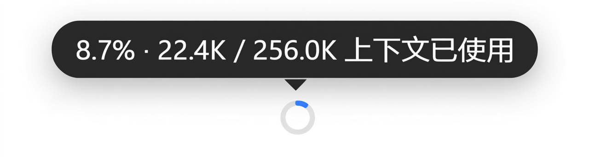
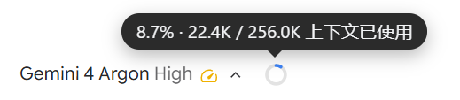
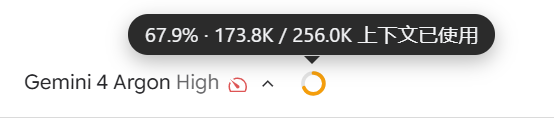
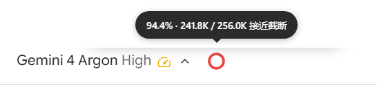
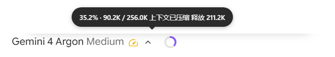
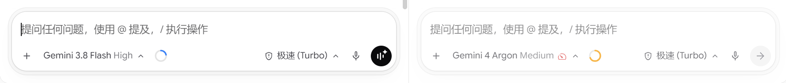
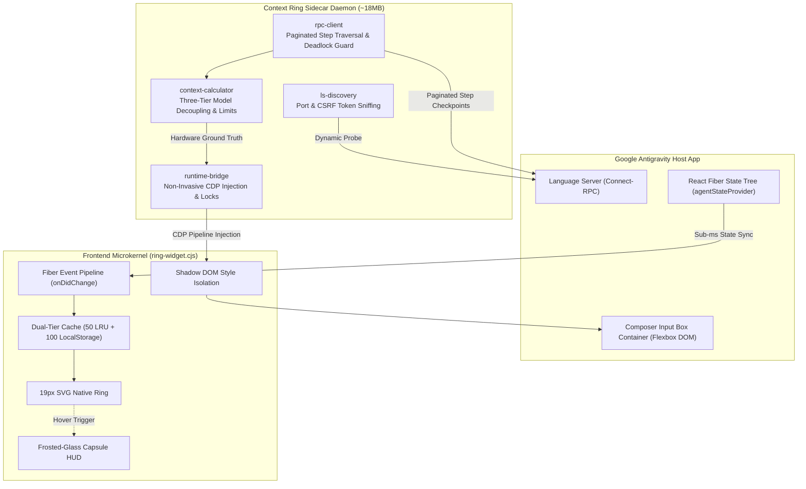

<div align="center">

# Antigravity Context Ring

**Native inline context window monitor & token usage telemetry for Google Antigravity Desktop App (Antigravity App)**  
*Zero-invasion, Connect-RPC ground-truth, 0ms instant switch, ~18MB footprint.*

[](https://github.com/brien9/antigravity-context-ring/releases)
[](#)
[](#)
[](LICENSE)

<a href="README.md">简体中文</a> | <a href="README_EN.md">English</a>

<br><br>



<sub>19×19px native micro-ring mounted directly beside the model selector · Silent ambient companion, sub-millisecond frosted-glass telemetry HUD on hover</sub>

</div>

---

## ⚡ Quick Start

Zero external dependencies. Hot-injected into running Antigravity App within seconds.

> [!TIP]
> **🤖 Agent Auto-Install (Recommended · Zero Terminal Interaction)**  
> Simply copy and send this prompt to your Antigravity Assistant:  
> `Clone https://github.com/brien9/antigravity-context-ring.git and run node manage.mjs install`

### 💻 Manual Installation

```bash
git clone https://github.com/brien9/antigravity-context-ring.git && cd antigravity-context-ring

# Run the installer for your environment:
node manage.mjs install    # Universal (Recommended)
.\install.ps1              # Windows (PowerShell)
sh ./install.sh            # macOS / Linux
```
<sub>Management: `node manage.mjs status` (inspect) · `node manage.mjs uninstall` (clean rollback, resets upon host restart)</sub>

---

## 💡 Why Context Ring?

During marathon autonomous coding sessions in Google Antigravity App, developers routinely hit a frustrating wall:
- **The True Culprit Behind "Sudden Amnesia": 256K Forced Lossy Compression**:  
  Many developers assume the model is randomly "hallucinating" or becoming dumber mid-task. The harsh reality is **Antigravity's black-box auto-compaction mechanism**. The moment a conversation reaches **256K tokens** (or 128K for Pro models), the client silently triggers background **forced compaction**.  
  Crucially, this is **lossy compression**: nuanced architectural constraints, step-by-step reasoning, and debugging history are brutally summarized and pruned, turning a sharp assistant into an amnesiac overnight.
- **Debunking the Myth: 256K is NOT the Model Limit**:  
  It is vital to separate foundation model capabilities from client-side rate controls. **256K is never the model's actual context ceiling**. Modern Gemini and Claude APIs natively support 1M to 2M token windows, and upstream API endpoints never enforce a 256K ceiling. The 256K hard cap exists purely as a **client-side subscription throttling gate** deployed by Google to curb server GPU consumption and preserve high-frequency quota velocity.
- **Flying Blind vs. Ground-Truth Radar**:  
  Antigravity's native UI provides zero real-time context metrics and never warns before truncating your work. Context Ring refuses theoretical 1M/2M marketing illusions, locking onto the **actual 256K physical cliff edge**. It alerts you as you approach the danger zone (≥90% alert red) and tracks lossy compaction drops, empowering you to wrap up, branch, or hand off tasks *before* irreversible amnesia strikes.

**Context Ring** distills real-time context awareness into a 19px native inline SVG ring, delivering ground-truth accuracy, seamless nativeness, and instantaneous speed:

| Dimension | Native Black Box / Heuristic Extensions | Antigravity Context Ring |
| :--- | :--- | :--- |
| **Denominator Baseline** | Relies on theoretical 1M/2M marketing numbers; ignores client-side 256K hard cap | **Aligned with physical 256K throttling limit**; warns before lossy compression and amnesia occur |
| **Token Measurement** | Naive character estimation (`4 chars/token`); severely degrades with multilingual text & indented code | **Connect-RPC ground-truth telemetry**; reads `modelUsage` directly from Language Server (including Cache tokens) |
| **Subagent Concurrency** | Subtasks invoking lightweight models corrupt the denominator, causing percentage spikes | **Three-tier model decoupling**; denominator capacity is strictly locked by the primary user-selected model (`selectedModel`) |
| **UI Ergonomics** | Clunky external windows or verbose status bars that interrupt coding flow | **19px inline geometric alignment + Shadow DOM isolation**; adapts to dark/light theme, reveals HUD on hover |
| **Session Switching & Resiliency** | White-screen delays on switch; resets to zero on temporary disconnects or host reloads | **L1 memory + L2 persistent dual-tier SWR**; 0ms instant display upon switching, never resets active values on disconnect |
| **Host Safety & Upgrades** | Patches or unpacks `resources/app.asar`, risking breakage on host updates | **100% non-invasive CDP injection**; `resources/app.asar` remains untouched; ~18MB memory footprint |

---

## 🎨 Visual States & Split View Isolation

### 1. Convergent Dual-Track Color Hierarchy

The ring progresses smoothly with context usage. Standard conversations follow a four-tier palette (Electric Blue `<60%` ➔ Amber Yellow `60-80%` ➔ Warm Orange `80-90%` ➔ Pure Alert Red `≥90%`). Once context compaction is detected (manual `/compact` or auto-compaction), the safe phase (`<60%`) switches to a luminous **Lavender Violet (`#a78bfa`)** to signify a compacted session, while seamlessly converging into the standard Amber ➔ Orange ➔ Pure Red warning track at `≥60%`.

| 🟢 Healthy / Early Phase (`< 60%`) | 🟡 Transition / Moderate (`60% ~ 80%`) |
| :---: | :---: |
| <br><sub>**Native Electric Blue (`#3b82f6`)**: Silent companion; fresh drafts with no messages display semi-transparent `0.0K`</sub> | <br><sub>**Warm Amber (`#f59e0b`)**: Signals session entering deeper context; monitor per-turn token payload</sub> |
| 🔴 Critical Threshold (`≥ 90%`) | 🟣 Compaction Triggered (`Compacted < 60%`) |
| =90%) - approaching 128K/256K auto-compaction truncation threshold" width="380"><br><sub>**Pure Alert Red (`#ff2626`)**: Approaching physical truncation threshold; wrap up or branch session</sub> | <br><sub>**Lavender Violet (`#a78bfa`)**: Identifies compacted history; HUD displays reclaimed token capacity</sub> |

### 2. Split View Multi-Pane Isolation

Engineered for power users with multi-composer parallel workflows. Each visible input box is managed by an independent state-machine lifecycle (`Map<box, PaneRingInstance>`):

<p align="center">
  
  <br>
  <em>Split View in action: each pane binds directly to its React Fiber node; drafts and active sessions remain strictly isolated with zero cross-talk</em>
</p>

* **Zero Cross-Talk Guarantee**: Each pane binds directly to its corresponding Fiber node without falling back to global route state, preventing draft boxes on the right from reflecting data from active sessions on the left.
* **Same-Session Synchronization**: When two panes view the same conversation, token increments on either pane reflect instantaneously across both rings.

---

## 🏗️ Under the Hood



* **Hardware-Grade RPC Ground Truth (Zero Character Guessing)**: Adhering to professional harness engineering standards, telemetry reads `modelUsage` structures directly from the local Language Server over Connect-RPC, capturing input, output, `cacheReadTokens`, and `cacheCreationTokens`.
* **Three-Tier Model Decoupling Engine**: Decouples `selectedModel` (the UI-selected model that strictly dictates capacity denominator), `executionModel` (the subtask execution model), and `checkpointModel` (the snapshot model), preventing lightweight subagents (e.g. `flash_lite`) from distorting primary telemetry.
* **Dual-Tier SWR & Never-Reset Guard**: 50-session in-memory LRU + 100-session persistent LocalStorage cache. Switching historical conversations renders valid snapshots in 0ms followed by silent background calibration. On host reloads or transient disconnects, the ring locks the latest verified state rather than blinking to zero.
* **Authoritative Total + Tail Window**: Bypasses the 1,000-step ceiling of a single RPC query. For trajectories over 5,000 steps, it reads the authoritative `stepCount` and analyzes the newest 5,000-step window, so the current checkpoint is never hidden by an old prefix and the tooltip explicitly marks a long-session tail window.

---

## ❓ Frequently Asked Questions (FAQ)

<details>
<summary><strong>Q1: Why does Antigravity trigger auto-compaction at 256K (or 128K)? Is 256K the actual model limit?</strong></summary>

> **A**: **Absolutely not. It is vital to separate foundation model capacity from client-tier quota strategy:**
> 1. **256K is NOT the model limit**: Underlying models (such as Gemini and Claude) natively support 1M–2M context windows through their official APIs. The API never bottlenecks at 256K.
> 2. **Client-side caps exist purely to control subscription costs**: Google locks the Antigravity desktop client to a 256K physical ceiling (128K for Pro models) solely to throttle GPU compute expenditure and prevent power users from burning through infrastructure quotas too quickly.
> 3. **The true culprit behind amnesia is "lossy compression"**: Once 256K is hit, Antigravity triggers server-side Auto-Compaction. This is an aggressive, lossy summarization process that discards prior code nuances, directly causing Gemini to "lose its memory" and hallucinate late in a session.
>
> Context Ring rejects 1M/2M vanity metrics, strictly anchoring the denominator to this real 256K tripwire so you retain full control before catastrophic context loss occurs.
</details>

<details>
<summary><strong>Q2: How does Context Ring monitor real-time token usage in Google Antigravity without modifying the app.asar file?</strong></summary>

> **A**: The plugin uses a **100% non-invasive architecture**. It never unpacks, patches, or modifies host binaries or `resources/app.asar`. Instead, a lightweight background sidecar connects to the client runtime via the standard Chrome DevTools Protocol (CDP), injecting a zero-dependency vanilla JS microkernel. The sidecar queries the local Language Server via Connect-RPC for hardware-level `modelUsage` metrics and attaches the inline SVG ring to the composer DOM. Host app updates remain completely frictionless, and uninstalling leaves zero residue.
</details>

<details>
<summary><strong>Q3: When using concurrent subagents or Split View panes, how does Context Ring avoid token spikes and cross-pane pollution?</strong></summary>

> **A**: Context Ring enforces **three-tier model decoupling** and **pane-isolated state trees** across frontend and backend. The denominator capacity is solely locked by the primary user-selected model (`selectedModel`), so subagents invoking lightweight helper models will never tamper with the main progress ratio. In the UI, each input container is managed independently (`Map<box, PaneRingInstance>`) and binds exclusively to its own React Fiber node, completely preventing cross-talk between split panes.
</details>

<details>
<summary><strong>Q4: Does the background daemon affect Antigravity performance or consume significant memory?</strong></summary>

> **A**: **Not at all**. The background Node.js sidecar daemon maintains an ultra-light footprint of approximately **~18MB of RAM** and near-**0% CPU** consumption. The frontend injection layer consists of lightweight native DOM and SVG elements with zero framework dependencies (no React/Vue overhead). Combined with a 250ms debounced event throttle and a host-bound watchdog that terminates automatically when the app closes, it introduces zero overhead to typing or client rendering.
</details>

---

## 📄 License

This project is open-source and licensed under the [MIT License](LICENSE).
