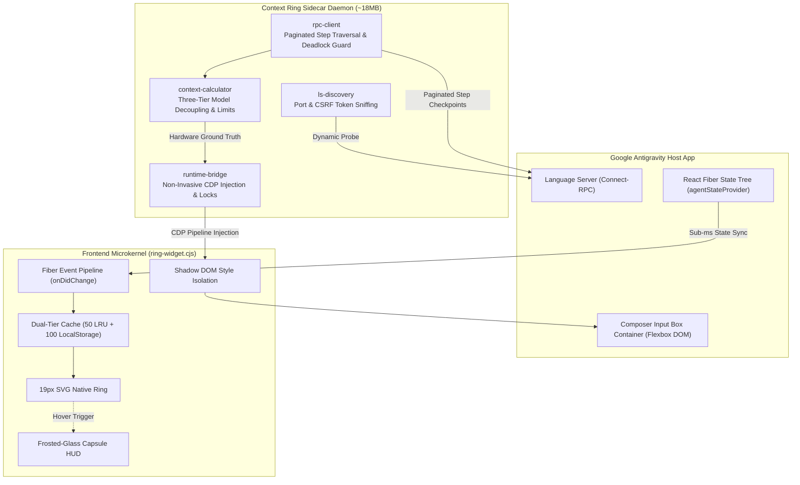

<div align="center">

# Antigravity Context Ring

**Native inline context window monitor & token usage telemetry for Google Antigravity Desktop App (Antigravity App)**  
*Zero-invasion, Connect-RPC ground-truth, 0ms instant switch, ~18MB footprint.*

[](https://github.com/brien9/antigravity-context-ring/releases)
[](#)
[](#)

[](#)
[](#)
[](#)
[](#)

<a href="README.md">简体中文</a> | <a href="README_EN.md">English</a>

<br><br>


</div>

---

## ⚡ Quick Start

Zero external dependencies. Hot-injected into running Antigravity App within seconds.

> [!TIP]
> **🤖 Agent Auto-Install (Recommended · Zero Terminal Interaction)**  
> Simply copy and send this prompt to your Antigravity Assistant:  
> `Clone https://github.com/brien9/antigravity-context-ring.git and run node manage.mjs install`

### 💻 Manual Installation

```bash
git clone https://github.com/brien9/antigravity-context-ring.git && cd antigravity-context-ring

# Run the installer for your environment:
node manage.mjs install    # Universal (Recommended)
.\install.ps1              # Windows (PowerShell)
sh ./install.sh            # macOS / Linux
```
<sub>Management: `node manage.mjs status` (inspect) · `node manage.mjs uninstall` (clean rollback, resets upon host restart)</sub>

---

## 💡 Why Context Ring?

Foundation models natively support ~1M context, but the Antigravity client hard-caps truncation at **256K** and forces lossy compaction at that point. The native UI never shows remaining context and never warns before it happens.

**Context Ring** turns that real cutoff into a 19px inline ring:

| Dimension | Native Host UI | Heuristic Scripts / Approx | Antigravity Context Ring |
| :--- | :--- | :--- | :--- |
| **Denominator Baseline** | Silent auto-compaction at 256K | Often assumes 1M, missing actual limit | **Locked to 256K physical boundary** with visual alert |
| **Token Measurement** | Internal tracking; no live indicator | Character approximations, misses cache tokens | **Connect-RPC snapshots** from real `modelUsage` |
| **UI Integration** | Clean, distraction-free | Detached floating window or CLI polling | **19px inline SVG ring** with frosted-glass HUD on hover |
| **Multi-Pane Concurrency**| Native split panes | Susceptible to global route crosstalk | **React Fiber state tree isolation** per active pane |
| **Host Footprint** | Official baseline | Some scripts patch `app.asar` | **CDP injection**, zero file changes, ~18MB RAM |

---

## 🎨 Visual States & Split View Isolation

### 1. State Progression & Color Feedback

The ring progresses smoothly with context usage. Standard conversations follow a four-tier palette (Electric Blue `<60%` ➔ Amber Yellow `60-80%` ➔ Warm Orange `80-90%` ➔ Pure Alert Red `≥90%`). Once context compaction is detected (manual `/compact` or auto-compaction), the safe phase (`<60%`) switches to a clear **Lavender Violet (`#a78bfa`)** to denote an active compacted session, smoothly connecting into the standard Amber ➔ Orange ➔ Pure Red alert stages at `≥60%`.

| 🟢 Healthy / Early Phase (`< 60%`) | 🟡 Transition / Moderate (`60% ~ 80%`) |
| :---: | :---: |
|  |  |
| 🔴 Critical Threshold (`≥ 90%`) | 🟣 Compaction Triggered (`Compacted < 60%`) |
| =90%) - approaching 256K auto-compaction truncation threshold" width="100%" style="border-radius: 6px; box-shadow: 0 2px 8px rgba(0,0,0,0.08);"> |  |

### 2. Split View Multi-Pane Isolation

Engineered for power users with multi-composer parallel workflows. Each visible input box is managed by an independent state-machine lifecycle (`Map<box, PaneRingInstance>`):

<p align="center">
  
  <br>
  <em>Split View in action: Left pane Gemini 3.8 Flash (draft/healthy) & right pane Gemini 4 Argon (active/alert) operate with zero cross-talk</em>
</p>

* **Zero Cross-Talk Guarantee**: Each pane binds directly to its corresponding Fiber node without falling back to global route state, preventing draft boxes on the right from reflecting data from active sessions on the left.
* **Same-Session Synchronization**: When two panes view the same conversation, token increments on either pane reflect instantaneously across both rings.

---

## 🏗️ Under the Hood



* **Hardware-Grade RPC Ground Truth (Zero Character Guessing)**: Adhering to professional harness engineering standards, telemetry reads `modelUsage` structures directly from the local Language Server over Connect-RPC, capturing input, output, `cacheReadTokens`, and `cacheCreationTokens`.
* **Three-Tier Model Decoupling Engine**: Decouples `selectedModel` (the UI-selected model that strictly dictates capacity denominator), `executionModel` (the subtask execution model), and `checkpointModel` (the snapshot model), preventing lightweight subagents (e.g. `flash_lite`) from distorting primary telemetry.
* **Dual-Tier SWR & Never-Reset Guard**: 50-session in-memory LRU + 100-session persistent LocalStorage cache. Switching historical conversations renders valid snapshots in 0ms followed by silent background calibration. On host reloads or transient disconnects, the ring locks the latest verified state rather than blinking to zero.
* **Authoritative Total + Tail Window**: Bypasses the 1,000-step ceiling of a single RPC query. For trajectories over 5,000 steps, it reads the authoritative `stepCount` and analyzes the newest 5,000-step window, so the current checkpoint is never hidden by an old prefix and the tooltip explicitly marks a long-session tail window.

---

## ❓ Frequently Asked Questions (FAQ)

<details>
<summary><strong>Q1: How does Context Ring monitor real-time token usage in Google Antigravity without modifying the app.asar file?</strong></summary>

> **A**: The plugin uses a **100% non-invasive architecture**. It never unpacks, patches, or modifies host binaries or `resources/app.asar`. Instead, a lightweight background sidecar connects to the client runtime via the standard Chrome DevTools Protocol (CDP), injecting a zero-dependency vanilla JS microkernel. The sidecar queries the local Language Server via Connect-RPC for `modelUsage` metrics and attaches the inline SVG ring to the composer DOM. Host app updates remain completely frictionless, and uninstalling leaves zero residue.
</details>

<details>
<summary><strong>Q2: When using concurrent subagents or Split View panes, how does Context Ring avoid token spikes and cross-pane pollution?</strong></summary>

> **A**: Context Ring enforces **three-tier model decoupling** and **pane-isolated state trees** across frontend and backend. The denominator capacity is solely locked by the primary user-selected model (`selectedModel`), so subagents invoking lightweight helper models will never tamper with the main progress ratio. In the UI, each input container is managed independently (`Map<box, PaneRingInstance>`) and binds exclusively to its own React Fiber node, completely preventing cross-talk between split panes.
</details>

<details>
<summary><strong>Q3: Does the background daemon affect Antigravity performance or consume significant memory?</strong></summary>

> **A**: **Not at all**. The background Node.js sidecar daemon maintains an ultra-light footprint of approximately **~18MB of RAM** and near-**0% CPU** consumption. The frontend injection layer consists of lightweight native DOM and SVG elements with zero framework dependencies (no React/Vue overhead). Combined with a 250ms debounced event throttle and a host-bound watchdog that terminates automatically when the app closes, it introduces zero overhead to typing or client rendering.
</details>

---

## 📄 License

This project is open-source and licensed under the [MIT License](LICENSE).
